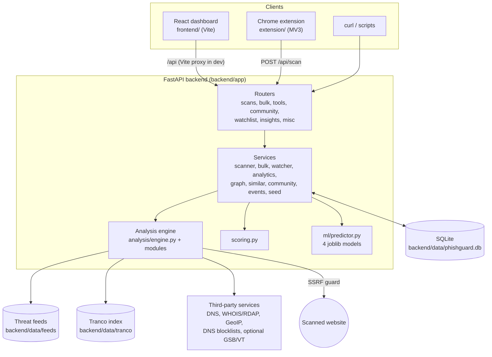
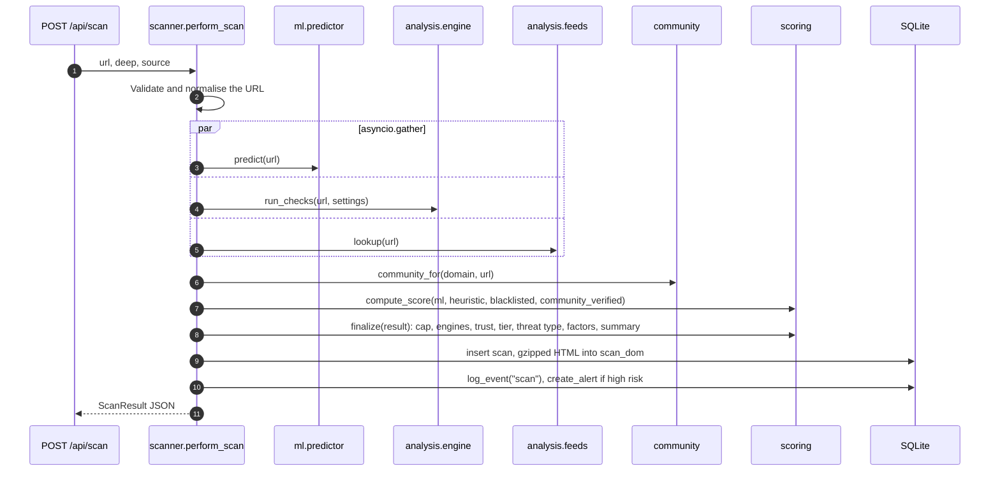
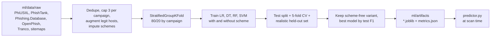
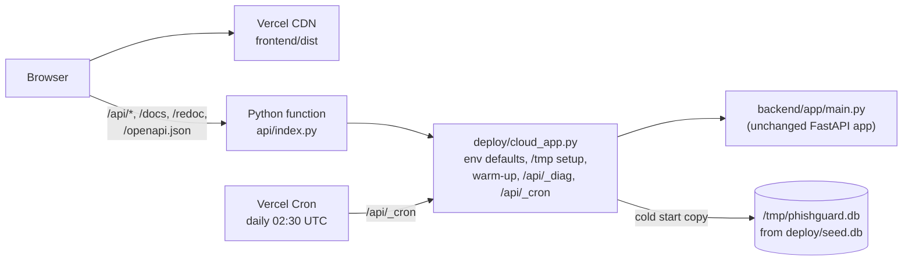

# PhishGuard architecture

This document describes how PhishGuard is put together: the clients, the FastAPI backend, the analysis engine, the machine-learning subsystem, the database, the background jobs, the Vercel demo deployment and the safety measures. Every module named here exists in the repository. For setup instructions see the [README](../README.md).

## Contents

- [System overview](#system-overview)
- [Backend application](#backend-application)
- [Scan pipeline](#scan-pipeline)
- [Analysis engine](#analysis-engine)
- [Risk scoring](#risk-scoring)
- [Machine-learning subsystem](#machine-learning-subsystem)
- [Database](#database)
- [Background jobs](#background-jobs)
- [Frontend](#frontend)
- [Browser extension](#browser-extension)
- [Vercel demo deployment](#vercel-demo-deployment)
- [Safety measures](#safety-measures)
- [Configuration](#configuration)

## System overview

There is one process. The dashboard, the extension and scripts all use the same REST API, so a scan behaves the same whatever started it. The `source` field of a scan records where it came from: `web`, `api`, `bulk`, `text`, `qr`, `watch`, `extension`, `community` or `seed`.

## Backend application

[`backend/app/main.py`](../backend/app/main.py) creates the FastAPI app (title "PhishGuard API", OpenAPI docs at `/docs` and `/redoc`, CORS open for the extension) and registers the routers. Its lifespan handler:

1. `db.init_db()` creates the tables and runs the idempotent migration.
2. Starts a background task that back-fills newer fields (trust score, tier, threat type, event links) on older rows, downloads the threat feeds if none are loaded, and seeds demo data into an empty database (unless `PHISHGUARD_NO_SEED=1`).
3. Starts the watchlist scheduler loop (unless `PHISHGUARD_NO_SCHEDULER=1`).
4. Resumes unfinished bulk jobs.

### Routers

| File | Prefix | Endpoints |
|---|---|---|
| [`routers/scans.py`](../backend/app/routers/scans.py) | `/api` | `POST /scan`, `GET /scans` (filters + pivots), `GET /scans/export`, `GET/PATCH/DELETE /scans/{id}`, `POST /scans/{id}/rescan`, `GET /scans/{id}/compare/{other_id}`, `GET /scans/{id}/dom`, `GET /scans/{id}/timeline`, `GET /domains/{domain}` |
| [`routers/insights.py`](../backend/app/routers/insights.py) | `/api` | `GET /graph`, `GET /scans/{id}/similar`, `GET /analytics/funnel` |
| [`routers/bulk.py`](../backend/app/routers/bulk.py) | `/api/bulk` | `POST /`, `POST /upload`, `GET /`, `GET /{id}` |
| [`routers/tools.py`](../backend/app/routers/tools.py) | `/api` | `POST /extract`, `GET /typosquat` |
| [`routers/community.py`](../backend/app/routers/community.py) | `/api/reports` | `POST /`, `GET /`, `GET /{id}`, `POST /{id}/vote` |
| [`routers/watchlist.py`](../backend/app/routers/watchlist.py) | `/api/watchlist` | `POST /`, `GET /`, `DELETE /{id}`, `POST /{id}/run`, `GET /{id}/history` |
| [`routers/misc.py`](../backend/app/routers/misc.py) | `/api/...` | alerts, feeds (status, refresh, search), events, settings, analytics (overview, timeseries, distribution, model, performance), `GET /health`, `GET /stats/live`, admin (seed, reset) |

### Services

| Module | Responsibility |
|---|---|
| [`services/scanner.py`](../backend/app/services/scanner.py) | The scan pipeline: normalise, run ML + engine + feed lookup concurrently, score, persist, log, alert |
| [`services/bulk.py`](../backend/app/services/bulk.py) | Bulk jobs (max 500 URLs) on background asyncio workers, 5 at a time, progress stored in the database |
| [`services/watcher.py`](../backend/app/services/watcher.py) | Watchlist re-checks, typosquat monitoring, change alerts, data retention |
| [`services/community.py`](../backend/app/services/community.py) | Reports and votes; verified at a net +3, rejected at -3 |
| [`services/analytics.py`](../backend/app/services/analytics.py) | Dashboard aggregations: KPIs, time series, distributions, model stats, performance, funnel |
| [`services/graph.py`](../backend/app/services/graph.py) | Relationship graph built from stored scans (node types: domain, URL, IP, ASN, name server, registrar, brand, redirect, country) |
| [`services/similar.py`](../backend/app/services/similar.py) | Other domains that share a scan's IP, ASN or registrar |
| [`services/filters.py`](../backend/app/services/filters.py) | Filters shared by `GET /api/scans` and the export |
| [`services/events.py`](../backend/app/services/events.py) | Activity log and alerts, with each event linked to its scan or domain |
| [`services/feeds_service.py`](../backend/app/services/feeds_service.py) | Background refresh of the threat feeds |
| [`services/settings_service.py`](../backend/app/services/settings_service.py) | Settings stored in the database, API keys masked in responses |
| [`services/seed.py`](../backend/app/services/seed.py) | Demo data: about 67 scans over 30 days, reports, votes, 3 watchlist items, alerts |

## Scan pipeline

`perform_scan()` in [`services/scanner.py`](../backend/app/services/scanner.py):

With `deep: false`, or when network checks are turned off in Settings, the engine skips all network work and the result is marked `tested_depth: "lexical"`.

## Analysis engine

[`analysis/engine.py`](../backend/app/analysis/engine.py) `run_checks(url, settings)` returns the domain information, SSL, HTTP, brand, reputation, popularity and content results, more than 50 checks, and a heuristic score. Each lookup runs under its own timeout, and a failure becomes an `error` entry instead of failing the scan.

| Module | What it does |
|---|---|
| `engine.py` | URL parsing, DNS (dnspython), WHOIS (python-whois), GeoIP (ip-api.com, then ipwho.is), SSL handshake and certificate parsing, HTTP probe and HTML analysis (forms, links, iframes, scripts, meta refresh, suspicious JavaScript, security headers, technologies), optional Google Safe Browsing and VirusTotal lookups, `build_checks()` and `score_checks()` |
| [`net_safety.py`](../backend/app/analysis/net_safety.py) | SSRF guard for every connection to the scanned site (see [Safety measures](#safety-measures)) |
| [`rdap.py`](../backend/app/analysis/rdap.py) | RDAP fallback (rdap.org) when the `whois` binary is missing or fails |
| [`feeds.py`](../backend/app/analysis/feeds.py) | Local blocklists: OpenPhish, URLhaus, Phishing.Database, PhishTank, Phishing Army |
| [`dnsbl.py`](../backend/app/analysis/dnsbl.py) | DNS blocklists: Spamhaus DBL, SURBL and URIBL for domains; Spamhaus ZEN and SpamCop for IPs |
| [`popularity.py`](../backend/app/analysis/popularity.py) | Tranco top-1M rank from a hashed index (`backend/data/tranco/tranco_index.npz`) |
| [`brands.py`](../backend/app/analysis/brands.py) | Impersonation of 92 brands: typosquat, homoglyph, combosquat, subdomain, punycode, path and content techniques |
| [`content.py`](../backend/app/analysis/content.py) | Page category (16 classes), language (langdetect) with translate link, parked detection, resources, contacted domains, trackers |
| [`typosquat.py`](../backend/app/analysis/typosquat.py) | dnstwist-style permutations (13 techniques) and async DNS resolution |
| [`text_extract.py`](../backend/app/analysis/text_extract.py) | URL extraction from email or SMS text, including defanged links and bare domains |

Check categories: **lexical** (16 checks such as IP host, `@` symbol, shortener, free hosting, suspicious TLD, punycode, executable download), **domain** (DNS resolves, domain age and expiry, WHOIS privacy, name servers, MX, SPF/DMARC), **network** (reachability, hosting location, private network host), **ssl** (enabled, valid, self-signed, expiry, certificate age), **content** (HTTP status, redirects, security headers, login form, sensitive inputs, off-site password form, suspicious JavaScript, hidden iframes, meta refresh, null and external links, urgency language, external favicon), **brand** (impersonation, official domain) and **reputation** (blocklists, DNS blocklists, engine ratio, Tranco popularity).

## Risk scoring

[`app/scoring.py`](../backend/app/scoring.py) combines the parts:

- `compute_score()`: `risk = round(0.6 x ML probability x 100 + 0.4 x heuristic)`, raised to at least 90 on a blocklist hit and to at least 85 for a verified community report. Verdict thresholds are 35 (suspicious) and 65 (phishing).
- `finalize()`: caps popular (Tranco top-10k) or official brand domains at 30 when nothing lists them (never for hosting, user-content or shortener platforms), adds the "PhishGuard ML" engine and recomputes the engine ratio, and sets the trust score (100 - risk), the tier (Trusted, Favorable, Neutral, Questionable, Untrusted), the threat type, the positive and negative factors and the plain-English summary.

The heuristic itself (`score_checks()` in the engine) is `100 x (1 - e^(-raw/18))`, where `raw` sums the weights of failed checks and 0.4 x the weights of warnings, with floors for strong signals and caps for official and top-10k domains. The README lists every floor and cap.

## Machine-learning subsystem

| File | Role |
|---|---|
| [`ml/features.py`](../backend/ml/features.py) | `normalize_url()` and `extract_features()`: the same code for training and prediction |
| [`ml/train.py`](../backend/ml/train.py) | Builds the dataset from snapshots in `ml/data/raw/`, removes known biases, makes a grouped 80/20 split, trains 4 models in 2 feature variants, evaluates them on the test split and on a held-out realistic set, and writes `ml/artifacts/` |
| [`ml/collect_legit.py`](../backend/ml/collect_legit.py) | Optional: samples real legitimate deep links from public sitemaps of Tranco domains |
| [`ml/predictor.py`](../backend/ml/predictor.py) | Loads the models once, predicts with the best model, returns every model's probability and the top 10 feature impacts |
| `ml/artifacts/` | `logistic_regression.joblib`, `decision_tree.joblib`, `random_forest.joblib`, `svm.joblib` and `metrics.json` (dataset, metrics, curves, confusion matrices, feature importance and statistics, legitimate medians, realistic evaluation) |

The explanation is a perturbation: for every feature that differs from the median legitimate training URL, the best model is asked again with that one feature set to the median, and the change in probability is that feature's signed impact.

## Database

SQLite in WAL mode ([`app/db.py`](../backend/app/db.py)), one connection per thread. The schema is created and migrated on startup.

| Table | Contents |
|---|---|
| `scans` | One row per scan: URL, domain, verdict, risk, ML probability, trust score, tier, threat type, category, IP, ASN, registrar, tested depth, tags, notes and the full result JSON |
| `scan_dom` | Gzipped HTML of the final page (up to 500 KB), kept out of the scan JSON |
| `reports`, `votes` | Community reports and their votes |
| `watchlist`, `watch_checks` | Monitored targets and their check history |
| `alerts` | Alerts with severity and read state |
| `events` | Activity log, each event linked to a scan or domain |
| `bulk_jobs`, `bulk_items` | Bulk jobs and their per-URL results |
| `settings` | Thresholds, toggles, retention and optional API keys |

## Background jobs

| Job | Where | What |
|---|---|---|
| Scheduler loop | `services/watcher.py` | Every 60 s: runs due watchlist checks (rescan, optional typosquat monitoring, alert on change) and applies data retention |
| Bulk workers | `services/bulk.py` | Up to 5 concurrent scans per job; unfinished jobs resume after a restart |
| Feed refresh | `services/feeds_service.py` | Downloads the feeds at first start and on `POST /api/feeds/refresh` |
| Demo seed | `services/seed.py` | Fills an empty database once (or on `POST /api/admin/seed`) |

## Frontend

React 19 + TypeScript + Vite 8, styled with Tailwind CSS 4. Server state is handled by TanStack Query, charts by Recharts and the graph by d3-force. Every page is a lazily loaded chunk ([`src/App.tsx`](../frontend/src/App.tsx)). The API clients are [`src/api/client.ts`](../frontend/src/api/client.ts) and [`src/api/client_v2.ts`](../frontend/src/api/client_v2.ts).

| Route | Page | What it shows |
|---|---|---|
| `/` | Overview | KPIs, scans over time, verdict split, risk histogram, brands, countries, alerts, model health, live feed |
| `/scan` | Scan | Single URL, email/SMS text (URL extraction) or QR code, deep-scan toggle, pipeline progress |
| `/scans/:id` | Report | Verdict header and 15 tabs (below) |
| `/history` | History | Search, filters, pivots, sorting, CSV/JSON export |
| `/domains/:domain` | Domain | Every scan of a domain and its risk trend |
| `/bulk`, `/bulk/:id` | Bulk Scan | Paste or upload up to 500 URLs, job progress and results |
| `/analytics` | Analytics | Trends, heatmap, distributions, threat types, tiers, categories, funnel, performance |
| `/graph` | Graph | Relationship graph across scans (d3-force) |
| `/model` | Model Lab | Dataset, model comparison, curves, confusion matrices, feature importance, realistic evaluation |
| `/watchlist` | Watchlist | Monitored targets, intervals, typosquat monitoring, check history |
| `/typosquat` | Typosquat | Look-alike permutations of a domain and which resolve |
| `/community` | Community | Reports, voting, verified / pending / rejected |
| `/feeds` | Threat Feeds | Feed status, entries per feed, search, top brands and TLDs |
| `/alerts` | Alerts | All alerts with read state |
| `/activity` | Activity Log | Audit trail of every action |
| `/settings` | Settings | Thresholds, network checks, integrations (API keys), retention, appearance |
| `/api-guide` | API Guide | Copy-paste REST API examples |

Report tabs ([`src/pages/Report.tsx`](../frontend/src/pages/Report.tsx) and [`src/pages/report/`](../frontend/src/pages/report)): Summary, ML Explanation, Domain, Geo & Hosting, SSL, HTTP, Content, Resources, Brand, Reputation, Screenshot, Source, Graph, Timeline and Raw JSON.

The layout ([`src/layout/Layout.tsx`](../frontend/src/layout/Layout.tsx)) has the sidebar, a quick-scan box, the alerts bell, light/dark/system themes, an API health indicator and the "Demo mode" banner, shown when `GET /api/health` returns `cloud: true`. In development, Vite proxies `/api`, `/docs`, `/redoc` and `/openapi.json` to the backend (`PHISHGUARD_API`, default `http://localhost:8000`).

## Browser extension

[`extension/`](../extension) is a Manifest V3 extension in plain JavaScript:

- `background.js` (service worker): auto-scans completed http(s) navigations with a quick scan (cached for 30 minutes), sets the coloured badge, shows notifications and adds the "Scan link with PhishGuard" context-menu item.
- `popup/`: the current tab, "Scan this page" (deep scan), the risk bar, the verdict, the top failed checks and a link to the full report.
- `options/`: backend URL, dashboard URL, auto-scan and banner toggles (stored in `chrome.storage.sync`).
- `content/banner.js`: the optional in-page warning banner.

Host access is limited to `localhost:8000` and `127.0.0.1:8000`. Any other origin is an optional permission requested only when needed.

## Vercel demo deployment

- [`vercel.json`](../vercel.json): installs and builds the frontend, rewrites the API paths to `api/index.py` (region `bom1`, 300 s maximum duration), falls back to `index.html` for client routes and schedules the cron.
- [`deploy/cloud_app.py`](../deploy/cloud_app.py): sets `PHISHGUARD_CLOUD=1`, `PHISHGUARD_DB_PATH=/tmp/phishguard.db`, `PHISHGUARD_NO_SEED=1` and `PHISHGUARD_NO_SCHEDULER=1` (Vercel project variables win), copies `deploy/seed.db` to `/tmp` on a cold start and shifts its timestamps so the charts look recent, mirrors `backend/data` into `/tmp` so writes work, unpacks `deploy/feeds/*.gz`, preloads the Tranco index, warms up the models, and adds `GET /api/_diag` and `GET /api/_cron` (up to 5 due watchlist checks plus retention; protected by `CRON_SECRET` when it is set).
- [`deploy/build_cloud_seed.py`](../deploy/build_cloud_seed.py): makes the snapshot from the local database (secrets removed, unfinished bulk jobs closed, large HTML dropped) and packs the feeds.
- [`deploy/preflight.py`](../deploy/preflight.py): checks the upload and bundle sizes, the pinned [`requirements.txt`](../requirements.txt) against the real imports, and the snapshot freshness; `--smoke` runs the cloud app locally.

Because the database lives in `/tmp`, data written on the demo is lost when the function restarts. Step-by-step deploy commands and troubleshooting are in [DEPLOY_NOTES.md](DEPLOY_NOTES.md).

## Safety measures

- **SSRF guard** ([`net_safety.py`](../backend/app/analysis/net_safety.py)): only `http`/`https` on ports 80, 443, 8080 and 8443. The host is resolved and every address must be globally routable (no loopback, private, link-local, CGNAT, multicast or reserved ranges, including IPv6 wrappers of them). The connection is pinned to the checked IP, so a DNS-rebinding answer cannot redirect it, and every redirect hop is checked again. A blocked target becomes a failed `private_network_host` check; the URL and ML analysis still run.
- **Bounded work**: per-lookup timeouts, at most 500 KB of stored HTML per scan, bulk jobs limited to 500 URLs and 5 concurrent scans.
- **Export safety**: CSV cells that start with `=`, `+`, `-`, `@`, a tab or a carriage return get a leading quote (spreadsheet formula injection).
- **Secrets**: Google Safe Browsing and VirusTotal keys are masked in API responses and removed from the cloud snapshot.
- **Extension**: minimal host permissions, optional permissions on demand.
- **Scope**: PhishGuard is an educational prototype. It has no user accounts or rate limiting, so the public demo must not hold private data.

## Configuration

| Variable | Default | Effect |
|---|---|---|
| `PHISHGUARD_DB_PATH` | `backend/data/phishguard.db` | SQLite file |
| `PHISHGUARD_NO_SEED` | unset | `1` = no demo seed on an empty database |
| `PHISHGUARD_NO_SCHEDULER` | unset | `1` = no watchlist / retention loop |
| `PHISHGUARD_CLOUD` | unset | `1` = demo mode (`/api/health` returns `cloud: true`) |
| `PHISHGUARD_API` | `http://localhost:8000` | Backend used by the Vite dev proxy |
| `CRON_SECRET` | unset | Bearer token required by `/api/_cron` on Vercel |

Settings stored in the database (defaults): suspicious threshold 35, phishing threshold 65, network checks on, screenshots off (thum.io), DNS blocklists on, RDAP on, request timeout 8 s, retention 365 days, no Google Safe Browsing or VirusTotal key.
